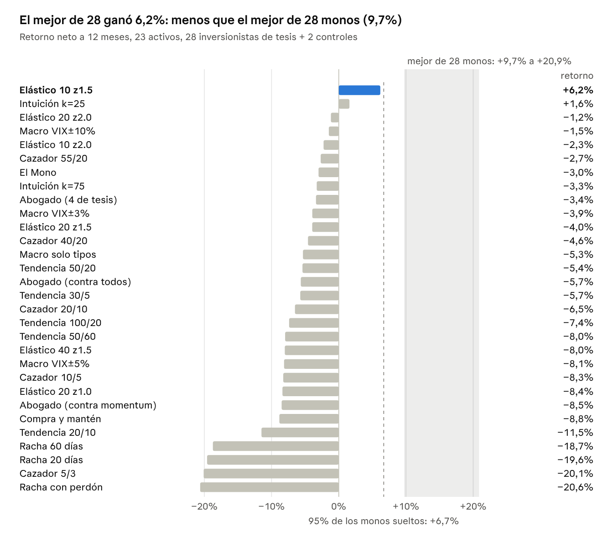
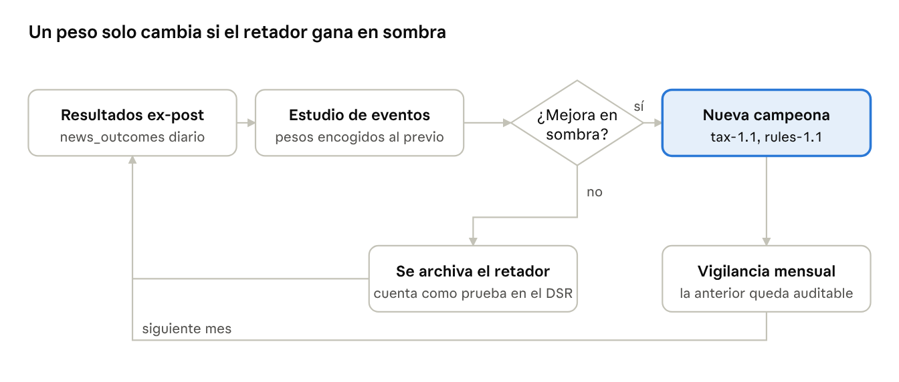
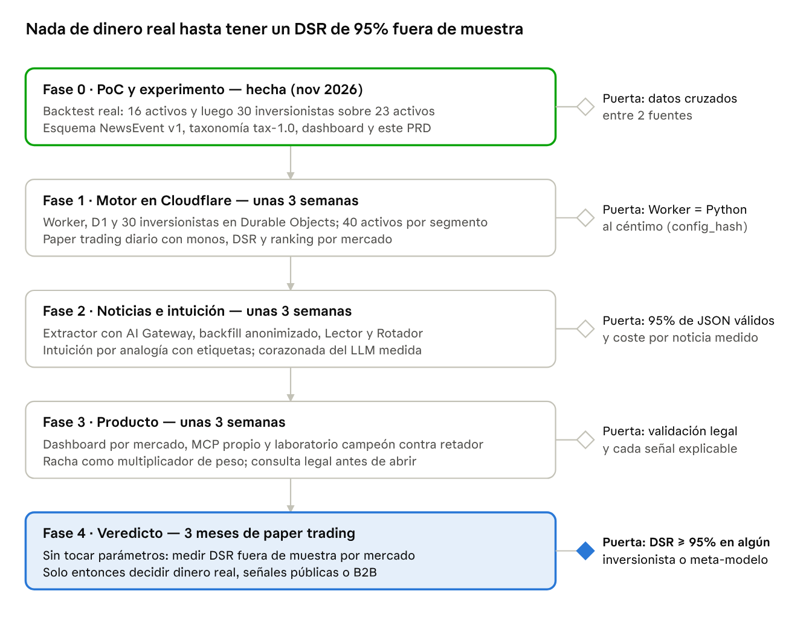

# PRD — Laboratorio de inversionistas determinísticos

Nov 21, 2026 · @Lusi Carlos Charris Molina

## Resumen

Un laboratorio donde entre 10 y 30 inversionistas virtuales, cada uno con una tesis y una regla fija, compiten en largo y corto sobre mercados reales. La IA solo convierte noticias en datos etiquetados; las decisiones son 100% determinísticas y auditables. El producto mide quién tiene ventaja real frente al azar, en qué mercados y con qué racha, antes de arriesgar un euro.

- **Para quién:** primero, inversores particulares que quieren entender el riesgo antes de invertir (el primer usuario es Luis). Después, fintechs, asesores y comunidades que necesitan señales explicables y un banco de pruebas honesto.

- **Por qué ahora:** 2026 trajo las mayores salidas a bolsa de la historia (SpaceX en junio, Anthropic el 19-nov) y una venta fuerte de IA tras las elecciones del 3-nov. Hay ruido de titulares como nunca, y los agentes de IA que operan por sí solos han mostrado ser erráticos (ver benchmark).

- **Diferencia en una frase:** los demás ponen a la IA a decidir; aquí la IA solo lee, y las reglas deciden con prueba contra 500 monos.

- **Estado:** prueba de concepto hecha con datos reales (16 activos, 252 sesiones). Especificación técnica: [Spec PoC](https://claude.ai/artifact/QyuSrtTRkNCxw3CjtRaH5G). Dashboard: [Simulador — PoC](https://claude.ai/artifact/3rNGQZFSu6fJSdELyZNfVu). Producto de CooWeb / LuchoIA.

## Benchmark: quién hace algo parecido

La idea de varios inversionistas de IA compitiendo ya existe y es popular, así que la pieza original no es esa. **Lo que nadie junta es: la IA solo como lectora, decisiones determinísticas reproducibles, prueba obligatoria contra el azar y ranking por mercado con racha.**

| Plataforma                                                                                                                                        | Qué hace                                                                                                                                                  | Quién decide               | ¿Se mide contra el azar?             | Qué tomamos / en qué nos diferenciamos                                                                                                                                                                                                                                                                                                                                                                                          |
|---------------------------------------------------------------------------------------------------------------------------------------------------|-----------------------------------------------------------------------------------------------------------------------------------------------------------|----------------------------|--------------------------------------|---------------------------------------------------------------------------------------------------------------------------------------------------------------------------------------------------------------------------------------------------------------------------------------------------------------------------------------------------------------------------------------------------------------------------------|
| [AI Hedge Fund (virattt)](https://www.edgen.tech/news/post/new-ai-hedge-fund-with-12-legendary-investors-gets-51k-github-stars)                   | Código abierto con 12 inversores legendarios como agentes (Buffett, Munger, Lynch); más de 51.700 estrellas en GitHub                                     | El LLM con cada persona    | No                                   | Valida que la idea engancha. Ellos simulan personalidades con prompts; nosotros fijamos reglas que no cambian de humor                                                                                                                                                                                                                                                                                                          |
| [TradingAgents (Tauric Research)](https://github.com/TauricResearch/TradingAgents)                                                                | Agentes LLM en roles de una mesa de trading: analistas, investigadores alcistas y bajistas que debaten, gestión de riesgo                                 | El LLM tras el debate      | No                                   | Su debate alcista contra bajista es primo de nuestro antagonista. En 2026 añadieron filtros contra el sesgo de anticipación: el problema es real                                                                                                                                                                                                                                                                                |
| [Alpha Arena (Nof1)](https://www.scmp.com/tech/tech-trends/article/3329784/deepseek-outperforms-ai-rivals-real-money-real-market-crypto-showdown) | Modelos de IA con 10.000 USD reales cada uno, operando cripto en Hyperliquid con ranking público                                                          | El LLM, sin humanos        | No                                   | La temporada 1 la ganó Qwen con +22,3% y GPT-5 perdió más del 62% ([TechNews](https://technews.tw/2025/11/04/ai-large-model-trading-contest-qwen-winner/)); a los perdedores se les criticó apalancamiento y exceso de operaciones ([análisis](https://medium.com/@farhat.hanne/alpha-arena-when-ais-fight-who-will-survive-3b179c84f7fa)). Es nuestro mejor argumento: 17 días y 6 jugadores no distinguen suerte de habilidad |
| [Numerai](https://blog.numer.ai/numercon-2026-genesis-to-singularity/)                                                                            | Miles de modelos envían predicciones, apuestan su token NMR y se combinan en un meta-modelo ponderado; ya convierte noticias en señales con un LLM propio | El meta-modelo             | Sí, por rendimiento fuera de muestra | El más cercano en espíritu y ya gestiona unos 700 M USD ([Decrypt](https://decrypt.co/373781)). Su meta-modelo inspira nuestro asignador por racha. Pero es su fondo cerrado, solo acciones y para científicos de datos                                                                                                                                                                                                         |
| [RavenPack](https://wrds-www.wharton.upenn.edu/pages/data-announcements/now-available-enhanced-news-and-data-analytics-by-ravenpack)              | Analítica de noticias institucional: más de 7.000 eventos detectados con sentimiento y relevancia, 20+ años de histórico                                  | No decide; vende datos     | No aplica                            | Es el modelo de nuestro JSON de metadatos. Nosotros: taxonomía abierta y versionada, extracción con LLM barata y en español                                                                                                                                                                                                                                                                                                     |
| [Composer by SoFi](https://www.therundown.ai/tools/composer)                                                                                      | Estrategias de reglas sin código, backtest y ejecución; 40 USD/mes; SoFi lo compró en junio de 2026                                                       | Reglas que crea el usuario | No                                   | Demuestra que las reglas venden y ya tiene MCP para Claude ([Product Hunt](https://www.producthunt.com/products/composer-2/launches)). Le falta la capa de noticias, la competencia entre tesis y el control de suerte                                                                                                                                                                                                          |
| [AI Fund (cubexch)](https://github.com/cubexch/ai-fund)                                                                                           | 45 agentes de trading para Claude Code: “contrata” agentes y “despide” a los que no cumplen sus KPI                                                       | Agentes LLM                | No                                   | Misma intuición de despedir por resultados que nuestra racha, pero sin prueba estadística: despedir por mala suerte es tan malo como premiar la buena                                                                                                                                                                                                                                                                           |

**Lecturas para el producto**

- El MCP no es diferencial por sí solo: Composer y Numerai ya lo tienen. Lo diferencial es lo que el MCP explica, el reason_json de cada decisión.

- El hueco de mercado es la honestidad medible: nadie publica el percentil frente al azar ni corrige por haber probado muchas variantes.

- Hispanohablantes de Europa y Latinoamérica no tienen una herramienta así en su idioma ni con sus mercados (IBEX, Bovespa, COLCAP).

## Problema, usuarios y casos de uso

**El problema:** quien empieza a invertir decide por titulares y por intuición, y las herramientas de IA le dan opiniones convincentes que no se pueden auditar ni repetir. Ninguna le dice lo más importante: si esa estrategia gana por habilidad o por suerte, y en qué mercado.

| Usuario                                        | Qué necesita                                                           | Primer caso de uso                                                  |
|------------------------------------------------|------------------------------------------------------------------------|---------------------------------------------------------------------|
| Inversor particular que empieza (Luis primero) | Entender riesgo antes de meter dinero; ver cómo habría ido cada estilo | “¿Qué habría pasado si iba corto en SpaceX tras su salida a bolsa?” |
| Inversor con cartera pequeña o mediana         | Saber qué tesis funciona en su mercado (Europa, emergentes, cripto)    | Ranking por mercado con su percentil frente al azar                 |
| Asesor, fintech o comunidad (fase B2B)         | Señales explicables y un banco de pruebas para sus propias reglas      | API y MCP: “explícame por qué El Elástico entró corto en Nvidia”    |
| Inversor ángel                                 | Ver tracción y rigor                                                   | Dashboard público con resultados en vivo y sin retocar              |

**Casos de uso del MVP**

1.  Ver el ranking de inversionistas, global y por mercado, con percentil frente al azar.

2.  Abrir cualquier decisión y leer su porqué: números de la regla y noticias que la empujaron.

3.  Lanzar un backtest de una tesis sobre un periodo y un mercado.

4.  Seguir el paper trading diario: qué haría cada uno mañana.

5.  Preguntar al sistema desde Claude con el MCP propio.

## Objetivos y métricas de éxito

El objetivo no es “ganar” en el backtest: es saber con rigor si alguien tiene ventaja. Por eso la métrica estrella es estadística, no de retorno.

| Objetivo                 | Métrica                                                       | Meta del MVP                                                               |
|--------------------------|---------------------------------------------------------------|----------------------------------------------------------------------------|
| Determinismo real        | Mismo config_hash = mismo resultado                           | 100% de corridas idénticas al céntimo                                      |
| Ventaja demostrada       | Sharpe deflactado (DSR) por número de inversionistas probados | Algún inversionista con DSR ≥ 95% en paper trading de 3 meses              |
| Calidad de la extracción | JSON válidos al primer intento                                | ≥ 95%                                                                      |
| Coste por noticia        | extraction.cost_usd medio                                     | Medido y publicado desde el día 1 (meta orientativa: céntimos por noticia) |
| Explicabilidad           | Decisiones con reason_json completo                           | 100%                                                                       |
| Frescura                 | Señales listas tras el cierre de EE. UU.                      | Antes de la apertura europea del día siguiente                             |
| Uso (fase producto)      | Usuarios que vuelven a ver el ranking cada semana             | Se mide desde el lanzamiento público                                       |

**No objetivos del MVP:** operar dinero real, dar recomendaciones personalizadas, alta frecuencia o intradía, apalancamiento.

## Requisitos funcionales del MVP

Prioridad: P0 = sin esto no hay MVP; P1 = entra si da tiempo; P2 = después.

| ID    | Requisito                                                                                                               | Prioridad |
|-------|-------------------------------------------------------------------------------------------------------------------------|-----------|
| RF-01 | Ingesta diaria de precios de los activos del universo a D1, con validación cruzada entre dos fuentes                    | P0        |
| RF-02 | Ingesta de noticias cada 15 min con filtro de fecha, deduplicación por historia y texto crudo en R2                     | P0        |
| RF-03 | Extracción de cada noticia al JSON NewsEvent con taxonomía cerrada, validación estricta y versión de prompt y taxonomía | P0        |
| RF-04 | Cálculo determinístico de effective_at, impacto y presión de noticias por activo                                        | P0        |
| RF-05 | Motor de inversionistas: cada uno es una regla pura con parámetros versionados; de 10 a 30 en paralelo                  | P0        |
| RF-06 | Libro mayor: señales, operaciones, costes, capital diario y reason_json por decisión                                    | P0        |
| RF-07 | Controles obligatorios: compra y mantén, mono, 2.000 monos para percentiles y el umbral del “mejor de N monos”          | P0        |
| RF-08 | Sharpe deflactado (DSR) por inversionista según el número de inversionistas probados                                    | P0        |
| RF-09 | Segmentación por mercado y por economía con ranking propio en cada segmento                                             | P0        |
| RF-10 | Variable de racha por inversionista y segmento, usada para ajustar peso con límites (ver sección de racha)              | P1        |
| RF-11 | Inversionista de intuición por analogía con situaciones pasadas                                                         | P1        |
| RF-12 | Corazonada del LLM registrada y puntuada (Brier), sin peso hasta que se lo gane                                         | P1        |
| RF-13 | Backtest bajo demanda por inversionista, periodo y segmento (Workflows)                                                 | P0        |
| RF-14 | Paper trading diario con publicación de posiciones antes de la apertura                                                 | P0        |
| RF-15 | Dashboard: ranking, curvas, mapa por mercado, “qué haría mañana”, noticias con su JSON                                  | P0        |
| RF-16 | MCP propio: ranking, explicar_decision, correr_backtest, presion_noticias, comparar_versiones                           | P0        |
| RF-17 | Laboratorio de versiones: campeón contra retador por inversionista (ver iteración)                                      | P1        |
| RF-18 | Escenarios Monte Carlo sobre las carteras actuales                                                                      | P2        |
| RF-19 | Inversionistas creados por el usuario con plantillas de reglas                                                          | P2        |

## De 10 a 30 inversionistas: qué cambia

Lo probé con 30 (28 de tesis en 7 familias más los 2 controles) sobre 23 activos. **Con más inversionistas siempre aparece uno que parece genial, y eso no prueba nada:** el mejor ganó 6,2% y supera al 94% de los monos sueltos, pero el mejor de 28 monos gana de mediana 9,7%.

exp30.py · cierres de Yahoo Finance vía Firecrawl · 20-nov-2025 a 20-nov-2026 · 2.000 monos

- **El listón sube con N.** Con 10 inversionistas, superar al percentil 95 de un mono era una prueba razonable. Con 28, el umbral correcto es el percentil 95 del mejor de 28 monos (+20,9%) o, de forma equivalente, un Sharpe deflactado alto. Por azar, el mejor de 28 debería tener un Sharpe anual de 1,36; el del ganador fue 0,49 y su DSR, 19% (hace falta ≥ 95%). Es la corrección por “selección con muchas pruebas” de [Bailey y López de Prado](https://papers.ssrn.com/abstract=2460551).

- **Variantes de la misma tesis no son inversionistas nuevos.** Cinco versiones de momentum cuentan como cinco pruebas, aunque piensen casi igual. Regla: máximo 3 variantes por familia en producción y medir la correlación entre ellos; si dos se parecen más de 0,8, sobra uno.

- **El coste de cómputo no es el problema.** 30 reglas sobre 23 activos y un año tardan segundos; en Durable Objects son 30 alarmas diarias. El coste real es estadístico.

- **Lo que sí sirve de tener muchos: el promedio.** Una cartera que toma la posición media de las 25 tesis (sin las rachas) perdió 2,3%, frente al −8,8% de comprar y mantener. Es la idea del meta-modelo de Numerai: muchas opiniones diversas promediadas valen más que el ganador de turno.

- **Lectura del año:** en un mercado de vaivenes ganaron las familias de reversión a la media y perdió el momentum. Eso es un dato sobre el régimen de 2026, no una ley.

## Intuición y racha: cómo hacerlas determinísticas

Ambas entran al producto, pero con reglas que las vuelven medibles. **La intuición se define como memoria de situaciones parecidas; la racha ajusta pesos despacio y nunca decide sola.** El experimento mostró por qué: perseguir al que va en racha fue lo peor del año.

### Intuición

1.  **Intuición por analogía (determinística, ya probada).** Para cada activo y día se arma una huella de 6 números: retorno de 5 y 20 días ajustado por volatilidad, distancia a su media de 20 días, cambio de volatilidad, VIX frente a su media y cambio de tipos a 10 años. Se buscan las k situaciones pasadas más parecidas (de cualquier activo, solo con resultado ya conocido). Si en el 60% o más el precio subió los 5 días siguientes, va largo; si en el 40% o menos, corto. En producción la huella suma las etiquetas de noticias (event_type, temas, factores macro): “esto se parece a la salida a bolsa de SpaceX”.

2.  **Corazonada del LLM (medida, sin peso al inicio).** Cada día la IA da un solo número de −1 a 1 por activo, con texto anonimizado y antes de conocerse el resultado. Se guarda y se puntúa (acierto y puntuación de Brier). Empieza con peso 0 y solo gana peso si supera a la moneda en al menos 200 predicciones de paper trading.

3.  **Tu intuición también compite.** El usuario puede registrar su propia apuesta del día y aparece en el ranking como un inversionista más. Es la forma más directa de aprender: ver tu racha real contra 30 reglas y 2.000 monos.

| Intuición por analogía | Global            | Mejor mercado                                                      | Lectura                                                       |
|------------------------|-------------------|--------------------------------------------------------------------|---------------------------------------------------------------|
| k = 25 vecinos         | +1,6% (2.º de 28) | Cripto +48,3% (comprar y mantener: −48,1%); EE. UU. índices +12,7% | Prometedora, pero dentro del umbral de suerte del mejor de 28 |
| k = 75 vecinos         | −3,3%             | —                                                                  | Con más vecinos se diluye la señal                            |

### Racha

**Definición:** por inversionista y mercado, tasa de acierto bayesiana de las últimas 60 sesiones, (10 + aciertos) / (20 + aciertos + fallos). El 10/20 inicial es el “perdón”: tira hacia el 50%, así que unos pocos fallos no hunden a nadie.

| Uso de la racha probado                                           | Retorno | Percentil vs monos |
|-------------------------------------------------------------------|---------|--------------------|
| Cada día, en cada mercado, copiar al mejor de los últimos 20 días | −19,6%  | 1%                 |
| Igual con los últimos 60 días                                     | −18,7%  | 2%                 |
| Igual con racha con perdón                                        | −20,6%  | 1%                 |
| Copiar al mejor de 60 días, revisando cada semana                 | −13,8%  | 12%                |
| Copiar al mejor de 60 días, revisando cada mes                    | −9,4%   | 33%                |
| Referencia: compra y mantén                                       | −8,8%   | 36%                |

Sin costes, la racha diaria aún pierde 13,7%: el problema no son solo las comisiones, es que el ganador reciente tiende a devolver lo ganado. **Reglas para la racha en el producto:**

- La racha ajusta el tamaño, no la dirección: multiplica el peso base entre 0,5× y 1,5×, y se recalcula una vez al mes.

- Solo cuenta con un mínimo de 20 operaciones en ese mercado.

- Una mala racha baja el peso pero nunca lo lleva a 0: puede fallar y no pasa nada.

- **“Dominó un mercado”** es una etiqueta formal: primero de su segmento durante 3 meses seguidos y por encima del umbral de suerte del mejor de N en ese segmento. Solo entonces es “especialista” y gana peso ahí, y solo ahí.

## Mercados y economías: segmentos y rankings por segmento

Cada activo lleva etiquetas de segmento y cada inversionista tiene un ranking por segmento, no solo uno global. Con 23 activos ya se ve el patrón: **casi todos los mercados tienen un “dominador” que supera al 90% de los monos, pero ninguno supera el umbral del mejor de 28 monos en su mercado.** Es decir, todavía nadie ha demostrado dominar un mercado.

| Segmento                    | Activos | Compra y mantén | Mejor inversionista | Su retorno | Supera a % de monos | Umbral de suerte (mejor de 28, p95) |
|-----------------------------|---------|-----------------|---------------------|------------|---------------------|-------------------------------------|
| EE. UU. tecnología e IA     | 6       | −21,3%          | Elástico 10 z1.5    | +56,7%     | 99%                 | +86,4%                              |
| Cripto                      | 4       | −48,1%          | Intuición k=25      | +48,3%     | 98%                 | +87,5%                              |
| EE. UU. índices             | 2       | +3,6%           | Intuición k=25      | +12,7%     | 96%                 | +28,2%                              |
| Materias primas             | 1       | +97,0%          | Cazador 20/10       | +78,6%     | 96%                 | +188,3%                             |
| Europa                      | 3       | +11,9%          | Elástico 10 z1.5    | +9,5%      | 93%                 | +28,2%                              |
| Refugio y tipos             | 2       | −9,0%           | Cazador 20/10       | +13,3%     | 92%                 | +40,8%                              |
| Emergentes                  | 4       | −3,3%           | Elástico 40 z1.5    | +8,3%      | 89%                 | +28,4%                              |
| Asia desarrollada           | 1       | +7,9%           | Cazador 10/5        | +10,6%     | 84%                 | +51,7%                              |
| *Economías desarrolladas*   | 12      | −6,4%           | Elástico 10 z1.5    | +30,6%     | 99,5%               | +38,6%                              |
| *Materias primas y refugio* | 3       | +26,4%          | Cazador 20/10       | +35,1%     | 98%                 | +57,9%                              |

Nota: en Europa y materias primas, el mejor inversionista ganó menos que comprar y mantener. Superar al mono no siempre significa superar a no hacer nada.

**Etiquetas de segmentación (cada activo puede tener varias):**

- **Clase de activo:** acciones, ETF de índice, cripto, materias primas, bonos, divisas.

- **Región:** EE. UU., Europa, Asia desarrollada, Latinoamérica, China, global.

- **Economía:** desarrollada, emergente, frontera, sin economía (cripto).

- **Sector:** tecnología e IA, banca, energía, consumo, espacio y defensa, etc.

- **Tamaño y liquidez:** megacap, mediana, pequeña; volumen medio diario.

- **Régimen (dinámico, calculado cada día):** VIX alto o bajo, tipos subiendo o bajando, tendencia o vaivén. Permite ver quién gana en cada clima de mercado.

**Universo a ampliar en fase 1 (prioridad hispana):** IBEX 35 y algunos valores españoles, Brasil (EWZ ya incluido), México (EWW ya incluido), Colombia, Chile y Perú, cobre y euro/dólar. Objetivo: al menos 4 activos por segmento, porque con 1 o 2 el umbral de suerte es tan alto que nadie lo cruza.

## Iteración de versiones y calibración de pesos

Los pesos se afinan con datos, pero con un ciclo lento y auditable: **un cambio de peso es una versión nueva que primero corre en sombra junto a la actual y solo la reemplaza si gana fuera de muestra.** Determinismo no significa pesos eternos; significa que cada versión es fija y reproducible.

ciclo mensual de calibración · campeón contra retador

1.  **Registrar el resultado de cada noticia.** Cuando pasa su horizonte, el Worker guarda el retorno anormal a 1, 5 y 20 días frente a su referencia (el índice o su sector) en news_outcomes.

2.  **Estudio de eventos por etiqueta.** Para cada event_type, tema, fuente y combinación frecuente se mide el retorno anormal medio y cómo se apaga en el tiempo. De ahí salen el peso observado y la vida media observada.

3.  **Encoger hacia lo previo.** peso nuevo = (n × peso observado + 50 × peso actual) / (n + 50), donde n es el número de eventos. Con pocos casos, el peso casi no se mueve; con muchos, manda el dato.

4.  **Validación por ventanas rodantes.** Se calibra con 12 meses y se prueba con los 3 siguientes sin tocar, dejando días de margen entre ambos para que no se contaminen. Luego se avanza la ventana.

5.  **Campeón contra retador.** La versión propuesta corre en paper trading en paralelo 1 a 3 meses. Pasa a campeona solo si mejora el Sharpe deflactado o la puntuación de Brier por encima de un margen fijado antes.

6.  **Todo intento cuenta.** Cada versión probada suma al número de pruebas del Sharpe deflactado. Si probamos 200 combinaciones, el listón es el de 200, no el de 1.

| Se puede calibrar                                 | No se calibra sobre el backtest                   |
|---------------------------------------------------|---------------------------------------------------|
| Pesos por event_type, fuente y tema               | La lógica central de cada tesis                   |
| Vidas medias por horizonte                        | Los costes (son datos del mercado, no parámetros) |
| Umbrales del Lector (±0,30)                       | Las reglas anti-sesgo                             |
| Peso de la corazonada del LLM (de 0 hacia arriba) | El periodo de prueba fuera de muestra             |
| Multiplicador de racha (0,5× a 1,5×)              |                                                   |

Ritmo: como máximo una calibración al mes y por familia. El MCP expone comparar_versiones para ver la diferencia entre campeona y retadora en cualquier periodo.

## Requisitos no funcionales

| Requisito        | Criterio                                                                                                                                 |
|------------------|------------------------------------------------------------------------------------------------------------------------------------------|
| Reproducibilidad | Cada corrida guarda reglas, parámetros, versión de taxonomía y de prompt, y datos de entrada; mismo config_hash = mismo resultado        |
| Point-in-time    | Ninguna regla puede leer un dato con fecha posterior a su instante de decisión; test automático que lo verifica en cada despliegue       |
| Auditabilidad    | Toda señal tiene reason_json; el JSON crudo de cada noticia vive en R2                                                                   |
| Escala           | 30 inversionistas × 50 activos × 10 años de backtest en minutos vía Workflows; paper trading diario en segundos                          |
| Coste            | Infraestructura en Cloudflare con pago por uso; IA barata para el volumen y modelo grande solo para lo tier 1; coste por noticia visible |
| Disponibilidad   | Si falla la ingesta, el sistema no inventa: marca el día como incompleto y no opera                                                      |
| Seguridad        | Claves en secretos de Workers; el MCP en modo lectura para terceros; sin datos personales de usuarios en el MVP                          |
| Idioma           | Interfaz y explicaciones en español primero; taxonomía en inglés para interoperar                                                        |

## Riesgos, regulación y anti-sesgos

**El riesgo regulatorio define el modelo de negocio.** En España, dar recomendaciones personalizadas sobre qué comprar, vender o mantener es asesoramiento en materia de inversión y exige autorización de la CNMV; poner “esto no es asesoramiento” no protege ([guía de la CNMV](https://www.cnmv.es/DocPortal/Publicaciones/Infografias/FinfluencersActuarResponsabilidad.pdf), [ficha de ESMA](https://www.esma.europa.eu/sites/default/files/2026-01/ES_Spain_es_-_Finfluencers_factsheet.pdf)). La ley excluye del asesoramiento las recomendaciones genéricas y no personalizadas ([texto refundido de la Ley del Mercado de Valores](https://www.cnmv.es/DocPortal/Legislacion/leyes/refunley6.pdf)). No soy abogado: esto hay que validarlo con un especialista antes de lanzar.

| Riesgo                                                     | Impacto | Mitigación                                                                                                                                                                                                          |
|------------------------------------------------------------|---------|---------------------------------------------------------------------------------------------------------------------------------------------------------------------------------------------------------------------|
| Que el producto se considere asesoramiento personalizado   | Alto    | MVP como laboratorio educativo y de investigación: resultados de reglas públicas, iguales para todos, sin perfilar al usuario ni decirle qué hacer con su dinero. Consulta legal antes de cobrar o publicar señales |
| Seleccionar al ganador por suerte                          | Alto    | Sharpe deflactado, umbral del mejor de N monos, todos los intentos registrados                                                                                                                                      |
| El LLM conoce el futuro en el backtest                     | Alto    | Anonimizar empresas; la validación que cuenta es el paper trading                                                                                                                                                   |
| Perseguir rachas                                           | Medio   | La racha solo ajusta tamaño, mensual, con límites (probado: copiar la racha diaria perdió ~20%)                                                                                                                     |
| Datos de proveedores (cortes, cambios de precio, términos) | Medio   | Dos fuentes por dato y día marcado incompleto si discrepan                                                                                                                                                          |
| Coste de IA por volumen de noticias                        | Medio   | Workers AI para el volumen, caché en AI Gateway, coste por noticia como métrica                                                                                                                                     |
| Pocos activos por segmento                                 | Medio   | Mínimo 4 activos por segmento antes de hablar de “dominio”                                                                                                                                                          |
| Expectativa de ganar dinero                                | Medio   | Comunicación honesta: el producto mide, no promete. Ningún dinero real hasta superar la prueba de 3 meses                                                                                                           |

Las reglas anti-sesgo técnicas (hora efectiva de la noticia, outcome aislado, costes de corto, supervivencia de activos) están en la [especificación](https://claude.ai/artifact/QyuSrtTRkNCxw3CjtRaH5G).

## Roadmap e hitos

roadmap por fases · duraciones estimadas

Cada fase cierra con una puerta medible. Las duraciones son estimaciones para una persona con IA y pueden moverse; las puertas no.

## Preguntas abiertas

- [ ] **Modelo de negocio:** ¿suscripción educativa para particulares, API y MCP para fintechs, o laboratorio de reglas a medida para asesores? Depende de la consulta legal.

- [ ] **Entidad que lo lanza:** ¿Cooweb LLC, CooWeb Colombia o una sociedad española nueva, pensando en CNMV y en los inversores ángeles?

- [ ] **¿Dashboard público desde el día 1?** Publicar resultados en vivo, incluidas las pérdidas, es el mejor argumento de confianza.

- [ ] **Universo final:** qué valores de España y Latinoamérica entran y con qué fuente de datos fiable para ellos.

- [ ] **Proveedor de noticias de pago:** ¿basta Firecrawl o compensa una fuente con histórico fechado al milisegundo para el backfill?

- [ ] **¿El usuario puede crear sus propios inversionistas?** Aumenta el engagement, pero también el número de pruebas: cada uno debe contar en su propio Sharpe deflactado.

- [ ] **Ronda ángel:** cuánto pedir y para qué hitos (lo natural es financiar fases 1 a 4).

## Fuentes

- Experimento propio: exp30.py sobre cierres de Yahoo Finance vía Firecrawl, 20-nov-2025 a 20-nov-2026, cruzados con Twelve Data.

- [Bailey y López de Prado, The Deflated Sharpe Ratio](https://papers.ssrn.com/abstract=2460551) · [How “Backtest Overfitting” Leads to False Discoveries](https://academic.oup.com/jrssig/article/18/6/22/7038278)

- Benchmark: [AI Hedge Fund](https://www.edgen.tech/news/post/new-ai-hedge-fund-with-12-legendary-investors-gets-51k-github-stars) · [TradingAgents](https://github.com/TauricResearch/TradingAgents) · [Alpha Arena (SCMP)](https://www.scmp.com/tech/tech-trends/article/3329784/deepseek-outperforms-ai-rivals-real-money-real-market-crypto-showdown) · [Alpha Arena, resultado final (TechNews)](https://technews.tw/2025/11/04/ai-large-model-trading-contest-qwen-winner/) · [Numerai, NumerCon 2026](https://blog.numer.ai/numercon-2026-genesis-to-singularity/) · [Numerai, activos (Decrypt)](https://decrypt.co/373781) · [RavenPack en WRDS](https://wrds-www.wharton.upenn.edu/pages/data-announcements/now-available-enhanced-news-and-data-analytics-by-ravenpack) · [Composer by SoFi](https://www.therundown.ai/tools/composer) · [AI Fund (cubexch)](https://github.com/cubexch/ai-fund)

- Regulación: [CNMV, guía para finfluencers](https://www.cnmv.es/DocPortal/Publicaciones/Infografias/FinfluencersActuarResponsabilidad.pdf) · [ESMA, ficha España](https://www.esma.europa.eu/sites/default/files/2026-01/ES_Spain_es_-_Finfluencers_factsheet.pdf) · [Ley del Mercado de Valores (texto refundido)](https://www.cnmv.es/DocPortal/Legislacion/leyes/refunley6.pdf)

- Documentos del proyecto: [Spec PoC](https://claude.ai/artifact/QyuSrtTRkNCxw3CjtRaH5G) · [Dashboard PoC](https://claude.ai/artifact/3rNGQZFSu6fJSdELyZNfVu)
