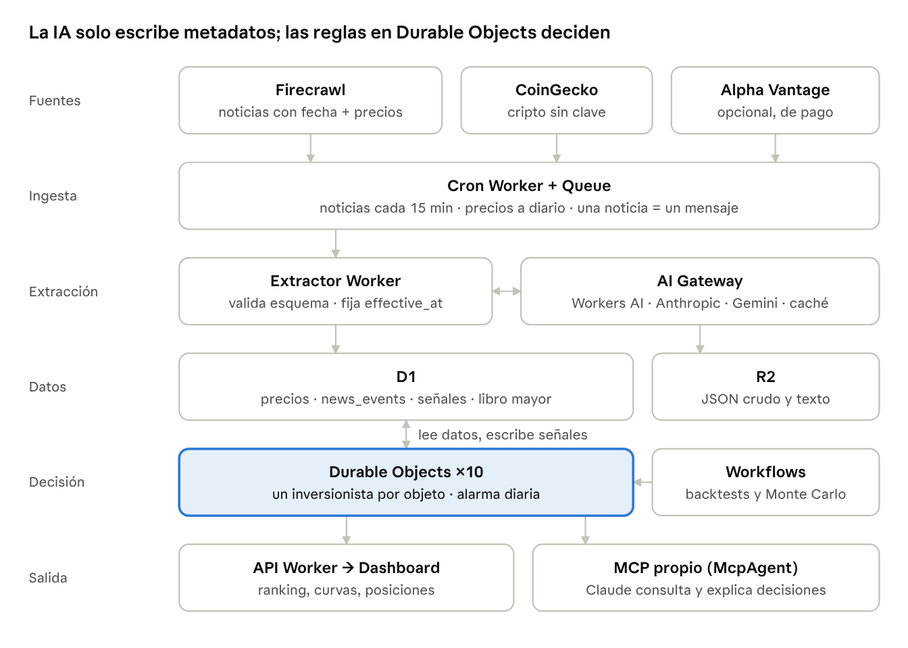
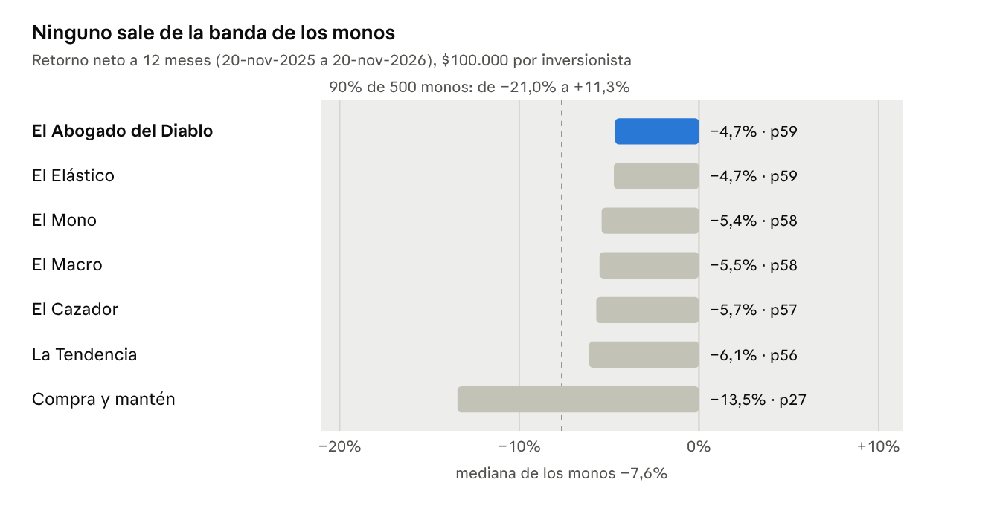
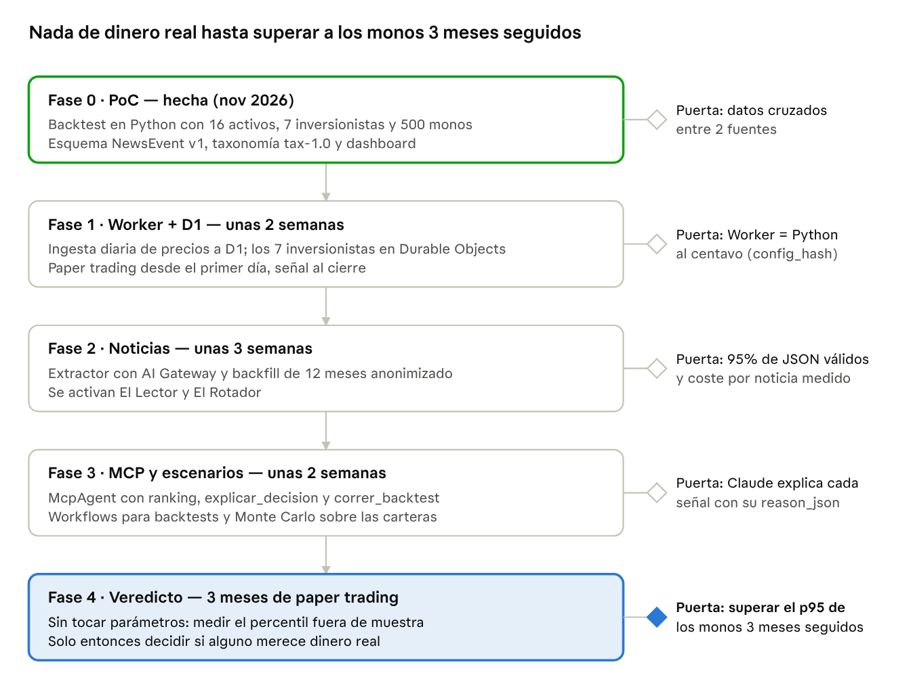

# Simulador de inversionistas determinísticos — Spec PoC

Nov 21, 2026 · @Lusi Carlos Charris Molina

## Objetivo y alcance

La PoC valida una sola pregunta: **¿algún inversionista determinístico le gana, de forma repetible y después de costos, a comprar y mantener y a un mono aleatorio?** Para responderla se monta un “mundo paralelo” con 10 inversionistas virtuales, cada uno con una tesis y una regla fija, que operan en largo, corto o fuera sobre el mismo universo de activos.

- **Pasado (backtest):** se reconstruye qué sabía cada inversionista en cada fecha, con precios y noticias fechadas, y se simula qué habría hecho.

- **Presente (paper trading):** los mismos inversionistas deciden cada día con datos nuevos; es la única validación libre de sesgos.

- **Futuro (escenarios):** Monte Carlo y estrés sobre las carteras actuales. No se predice el futuro: se mide cómo aguanta cada tesis.

La IA solo convierte texto en metadatos (el JSON de noticias). Todas las decisiones salen de reglas puras: mismas entradas, misma salida, siempre. Nada aquí es recomendación de inversión; es un laboratorio para entender riesgo antes de meter dinero real.

## Arquitectura en Cloudflare

arquitectura en Cloudflare · 6 capas

Los precios y las noticias entran por Cron, la IA convierte cada noticia en JSON una sola vez, y desde D1 hacia abajo todo es determinístico: cada inversionista es un Durable Object que lee datos y escribe señales, Workflows orquesta los backtests, y el MCP propio deja que Claude consulte el ranking y explique cualquier decisión con su reason_json.

## Universo de activos

La PoC opera 16 activos que cubren de baja a muy alta volatilidad, más 3 indicadores que no se operan (VIX, rendimiento del bono a 10 años y ANT en observación). Datos del 20-nov-2025 al 20-nov-2026, cierres diarios ajustados.

| Activo  | Qué es                     | Volatilidad | Retorno 12 m | Vol. anual | Peor caída |
|---------|----------------------------|-------------|--------------|------------|------------|
| SPY     | S&P 500 (ETF)              | baja        | +6,9%        | 14%        | −11,5%     |
| TLT     | Bonos EE. UU. 20+ años     | baja        | −4,4%        | 10%        | −12,5%     |
| GLD     | Oro (ETF)                  | baja        | −13,9%       | 29%        | −34,9%     |
| QQQ     | Nasdaq 100 (ETF)           | media       | +4,4%        | 22%        | −19,9%     |
| MSFT    | Microsoft                  | media       | +2,1%        | 34%        | −28,0%     |
| SAN.MC  | Banco Santander (Madrid)   | media       | +18,5%       | 32%        | −20,9%     |
| USO     | Petróleo (ETF)             | media       | +99,0%       | 51%        | −32,5%     |
| NVDA    | Nvidia                     | alta        | −30,3%       | 41%        | −47,5%     |
| TSLA    | Tesla                      | alta        | −12,5%       | 46%        | −39,1%     |
| PLTR    | Palantir                   | alta        | −7,9%        | 60%        | −44,8%     |
| BTC-USD | Bitcoin                    | alta        | −32,1%       | 44%        | −39,6%     |
| SPCX    | SpaceX (desde 12-jun-2026) | muy alta    | −20,6%       | 81%        | −48,8%     |
| CRWV    | CoreWeave                  | muy alta    | −42,9%       | 101%       | −71,4%     |
| COIN    | Coinbase                   | muy alta    | −57,2%       | 72%        | −63,2%     |
| ETH-USD | Ethereum                   | muy alta    | −42,8%       | 60%        | −53,4%     |
| SOL-USD | Solana                     | muy alta    | −48,5%       | 62%        | −57,0%     |

**Fuentes de datos validadas:** precios de Yahoo Finance a través del catálogo de datos de Firecrawl, cruzados con Twelve Data (diferencia máxima 0,4%, por ajuste de dividendos). Noticias con filtro de fecha desde la búsqueda de noticias de Firecrawl. CoinGecko responde desde el Worker sin clave para cripto. El sentimiento de noticias de Alpha Vantage es de pago: con la clave gratuita no está disponible, así que el sentimiento lo extrae nuestra propia IA.

ANT (Anthropic, salida a bolsa el 19-nov-2026) entra solo en la prueba en vivo: 2 sesiones no alcanzan para ningún indicador.

## JSON de metadatos de noticias (NewsEvent v1)

Cada noticia se convierte una sola vez en un JSON validado contra un esquema estricto (JSON Schema 2020-12, additionalProperties: false). La regla de oro: **la IA solo llena lo que sale del texto; el Worker llena todo lo que tiene que ver con tiempo y precios.** Así la IA nunca puede filtrar el futuro ni inventar una fecha.

| Bloque                  | Lo llena        | Qué guarda                                                                                                                                              |
|-------------------------|-----------------|---------------------------------------------------------------------------------------------------------------------------------------------------------|
| source                  | Worker + IA     | nombre, url, dominio, tier (1 a 4), tipo (agencia, regulador, comunicado, noticia, análisis, blog, social)                                              |
| timing                  | Worker          | published_at, time_known, market_session, **effective_at** (primer momento en que se puede operar)                                                      |
| content                 | IA              | título y resumen propio en español (máx. 400 caracteres)                                                                                                |
| entities\[\]            | IA              | símbolo, clase de activo, rol (principal, secundario, competidor, proveedor, cliente, proxy sectorial), relevancia 0–1, sentimiento −1–1, confianza 0–1 |
| classification          | IA              | event_type y secundarios, temas, factores macro, regiones (todo de vocabulario cerrado)                                                                 |
| signal                  | IA              | dirección, sorpresa, novedad, magnitud, horizonte, hype, incertidumbre                                                                                  |
| facts\[\]               | IA              | cifras textuales (métrica, valor, unidad, periodo, vs expectativa)                                                                                      |
| credibility             | IA              | rumor sí/no, confirmación oficial, fuentes que lo corroboran                                                                                            |
| dedup                   | Worker          | cluster_id de la historia y story_rank (1 = primer reporte)                                                                                             |
| extraction              | Worker          | proveedor, modelo, gateway, versión de prompt y de taxonomía, temperatura, anonimizado, coste                                                           |
| computed_market_context | Worker          | retornos, volatilidad, VIX y distancia a la media hasta effective_at                                                                                    |
| outcome                 | Worker, después | retorno 1 y 5 días y si la reacción fue contraria; **prohibido como entrada de decisión**                                                               |

Ejemplo real, la renuncia de Jensen Huang (Reuters, 12-nov-2026), tal como queda guardado:

{  
"schema_version": "news-event-1.0",  
"source": {"name": "Reuters", "tier": "tier1", "kind": "wire"},  
"timing": {"published_at": "2026-11-12T00:00:00Z", "time_known": false,  
"effective_at": "2026-11-13T14:30:00Z"},  
"content": {"title": "Nvidia CEO Jensen Huang resigns in blow to AI boom he helped foster",  
"summary_es": "Jensen Huang deja Nvidia tras un escándalo personal; Colette Kress asume como CEO interina."},  
"entities": \[  
{"symbol": "NVDA", "asset_class": "equity", "role": "primary", "relevance": 1.0, "sentiment": -0.75, "confidence": 0.9},  
{"symbol": "QQQ", "asset_class": "etf", "role": "sector_proxy", "relevance": 0.5, "sentiment": -0.3, "confidence": 0.6}  
\],  
"classification": {"event_type": "executive_change", "secondary_event_types": \["governance_scandal"\],  
"themes": \["semiconductors", "ai_capex", "china"\], "macro_factors": \["policy_uncertainty"\]},  
"signal": {"direction": "bearish", "surprise": 0.9, "novelty": 1.0, "magnitude": "high",  
"horizon": "weeks", "hype": 0.2, "uncertainty": 0.2},  
"extraction": {"model": "…", "prompt_version": "extract-1.0", "taxonomy_version": "tax-1.0",  
"temperature": 0, "anonymized": false},  
"outcome": {"ret_1d": -0.020, "reaction_divergence": false}  
}

El esquema completo y las 9 noticias convertidas están en el dashboard de la PoC, con cada JSON desplegable.

## Taxonomía de etiquetas (tax-1.0)

El LLM solo puede elegir valores de estas listas; un valor fuera de lista invalida el JSON y se reintenta. Los pesos son parte de la versión: cambiar un peso crea tax-1.1, y cada backtest guarda con qué versión corrió.

**Tipos de evento (42) con su peso y horizonte por defecto**

| Grupo       | event_type (peso · horizonte)                                                                                                                                                                                                                                                                                                                                                                                                                                                                                                                                         |
|-------------|-----------------------------------------------------------------------------------------------------------------------------------------------------------------------------------------------------------------------------------------------------------------------------------------------------------------------------------------------------------------------------------------------------------------------------------------------------------------------------------------------------------------------------------------------------------------------|
| Corporativo | earnings_beat / earnings_miss (0,80 · días), guidance_raise / guidance_cut (0,90 · semanas), executive_change (0,70 · semanas), governance_scandal (0,85 · semanas), m_and_a (0,80 · semanas), ipo_pricing / ipo_debut / secondary_offering (0,60 · días), lockup_expiry (0,50 · semanas), buyback_dividend (0,40), product_launch (0,40), partnership_contract (0,50), legal_regulatory_action (0,75), export_controls_trade (0,70), analyst_rating_change (0,40), insider_transaction (0,30), index_inclusion (0,50), short_report (0,60), security_incident (0,60) |
| Macro       | central_bank_decision (0,90 · semanas), central_bank_guidance (0,70), inflation_data (0,80 · días), jobs_data (0,70), growth_data (0,60), rates_move (0,60), election_policy (0,85 · semanas), fiscal_policy (0,60), geopolitical_conflict (0,70), commodity_shock (0,70)                                                                                                                                                                                                                                                                                             |
| Cripto      | etf_flows (0,60), exchange_hack (0,70), crypto_regulation (0,70 · semanas), protocol_event (0,40), liquidation_cascade (0,60 · intradía)                                                                                                                                                                                                                                                                                                                                                                                                                              |
| Mercado     | market_selloff (0,60), market_rally (0,50), sector_rotation (0,50), liquidity_supply (0,50 · semanas), volatility_spike (0,60), opinion_commentary (0,15)                                                                                                                                                                                                                                                                                                                                                                                                             |

**Resto de vocabularios**

| Etiqueta               | Valores                                                                                                                                                                                                              |
|------------------------|----------------------------------------------------------------------------------------------------------------------------------------------------------------------------------------------------------------------|
| Temas                  | ai_capex, ai_models, semiconductors, data_centers, cloud, space, ev_autonomy, crypto_etf, stablecoins, rates, inflation, oil_energy, banking, consumer, china, regulation_ai, defense, mega_ipo, europe, us_politics |
| Factores macro         | rates_up/down, inflation_up/down, usd_up/down, oil_up/down, growth_up/down, risk_on/off, liquidity_tightening/easing, policy_uncertainty                                                                             |
| Fuente (peso)          | tier1 1,00 (Reuters, AP, Bloomberg, SEC, comunicados oficiales) · tier2 0,85 (WSJ, FT, NYT, CNBC, Forbes) · tier3 0,60 (medios cripto, Benzinga, agregadores) · tier4 0,30 (blogs, redes)                            |
| Horizonte (vida media) | intradía 6 h · días 48 h · semanas 240 h · meses 720 h                                                                                                                                                               |
| Rol de la entidad      | primary, secondary, competitor, supplier, customer, sector_proxy, mentioned                                                                                                                                          |
| Dirección / magnitud   | bullish, bearish, neutral, mixed · low, medium, high                                                                                                                                                                 |

## Ponderación determinística: de etiquetas a señal

Cada entidad de cada noticia aporta un impacto que solo depende de su JSON y del reloj. La presión de noticias de un activo es la suma de impactos vigentes, aplastada con tanh para que quede entre −1 y +1.

\text{impacto} = s \cdot c \cdot r \cdot (0{,}5 + 0{,}5\\n) \cdot w\_{fuente} \cdot w\_{evento} \cdot (1 - 0{,}5\\h) \cdot (0{,}5 + sp) \cdot (1 - 0{,}5\\u) \cdot 0{,}5^{\Delta t / t\_{1/2}}

\text{presión}\_{activo}(t) = \tanh\Big(\sum\_{e \\:\\ effective\\at_e \le t} \text{impacto}\_e(t)\Big)

Donde s es el sentimiento hacia el activo (−1 a 1; si \|s\| \< 0,15 cuenta como 0), c la confianza, r la relevancia, n la novedad, h el hype, sp la sorpresa, u la incertidumbre, Δt las horas desde effective_at y t½ la vida media del horizonte.

- **Point-in-time por construcción:** una noticia con effective_at posterior a t aporta 0. La noticia de Reuters del 20-nov a las 22:00 UTC no existe para nadie hasta la apertura del lunes 23.

- **Hora desconocida = conservador:** si la fuente no da hora, cuenta desde la apertura siguiente.

- **El Lector** entra largo con presión ≥ +0,30 y corto con ≤ −0,30. Con las 9 noticias reales: la renuncia de Huang llevó la presión de NVDA a −0,57 al cierre del 13-nov (señal corta, que se mantuvo hasta el 17-nov), y la guía dura de la Fed llevó la del oro bajo −0,30 el 19-nov.

- **Lo que la fórmula no ve:** el beneficio de Nvidia superó expectativas y aun así la acción cayó 2,9% al día siguiente. Y el 20-nov Nvidia cayó 14% con la presión ya en −0,25, por debajo del umbral: el Lector se perdió el movimiento más grande. Esa reacción contraria se guarda en outcome.reaction_divergence para calibrar pesos después, nunca para decidir en el momento.

## Los 10 inversionistas

Siete ya corren sobre precios; tres esperan datos que la PoC aún no ingiere. Todos parten de \$100.000 repartidos en partes iguales entre los 16 activos, y en cada activo pueden estar largo, corto o fuera. Señal al cierre de t, ejecución en t+1.

| Inversionista         | Tesis                | Regla exacta                                                                                                                           | Etiquetas que usa                                       | Estado                               |
|-----------------------|----------------------|----------------------------------------------------------------------------------------------------------------------------------------|---------------------------------------------------------|--------------------------------------|
| Compra y mantén       | Control              | Siempre largo                                                                                                                          | —                                                       | corre                                |
| El Mono               | Control aleatorio    | Largo, corto o fuera al azar cada 5 sesiones (semilla 7); se compara con 500 monos                                                     | —                                                       | corre                                |
| La Tendencia          | Momentum             | Largo si cierre \> media 50 d y retorno 20 d \> 0; corto si al revés                                                                   | filtro opcional: direction reciente                     | corre                                |
| El Elástico           | Reversión a la media | z = (cierre − media 20 d) / desv. 20 d; largo si z \< −1,5, corto si z \> 1,5, sale en z = 0                                           | prioriza activos con hype alto (sobrerreacción)         | corre                                |
| El Cazador            | Ruptura de canal     | Largo al superar máximo de 20 d, corto al perforar mínimo; sale con canal de 10 d                                                      | volatility_spike como confirmación                      | corre                                |
| El Macro              | Régimen de riesgo    | VIX \> 1,05 × su media 20 d: corto alta beta, largo oro; VIX \< 0,95 × media: largo riesgo; tipos 10 años subiendo: corto bonos largos | macro_factors: rates_up, inflation_up, risk_off         | corre                                |
| El Abogado del Diablo | Antagonista          | Si 2 o más de los 4 de tesis coinciden en un activo, toma la contraria                                                                 | en fase 2: refuerza cuando hype \> 0,5                  | corre                                |
| El Lector             | Noticias             | Presión ≥ +0,30 largo, ≤ −0,30 corto                                                                                                   | todo el JSON                                            | demo con 9 noticias                  |
| El Rotador            | Rotación de liquidez | Corto en pares de una mega salida a bolsa durante su colocación y en desbloqueos; largo al terminar                                    | ipo_pricing, ipo_debut, lockup_expiry, liquidity_supply | necesita calendario de IPOs          |
| El Valorista          | Valor                | Largo lo más barato frente a su historia, corto lo más caro; mensual                                                                   | facts\[\] de resultados                                 | necesita fundamentales point-in-time |

El antagonista se diseñó como control de consenso, no como inverso puro: un inverso exacto pierde los costes dos veces y no enseña nada. Ir contra el consenso mide si el acuerdo entre tesis es señal o ruido.

Costes en todos: 0,10% por cada cambio de posición y coste anual de estar corto de 2% (líquidos), 8% (CRWV, SPCX, COIN, PLTR, TSLA) y 10% (cripto, como financiación de perpetuos).

## Modelo de datos: D1 para el libro mayor, Durable Objects para cada inversionista

D1 guarda todo lo que el dashboard consulta y compara (relacional, consultas por fecha y por inversionista). Cada inversionista vive en su propio Durable Object con SQLite interno y una alarma diaria: su estado es suyo y nadie más lo escribe. El JSON crudo de cada noticia y la respuesta del modelo van a R2.

-- catálogo  
CREATE TABLE assets (symbol TEXT PRIMARY KEY, name TEXT, asset_class TEXT, vol_tier TEXT, tradable INTEGER, listed_on TEXT);  
CREATE TABLE prices_daily (symbol TEXT, date TEXT, close REAL, adj_close REAL, volume REAL, source TEXT,  
PRIMARY KEY (symbol, date));  
  
-- noticias: columnas indexadas + JSON completo  
CREATE TABLE news_events (event_id TEXT PRIMARY KEY, published_at TEXT, effective_at TEXT, source_tier TEXT,  
event_type TEXT, direction TEXT, surprise REAL, novelty REAL, hype REAL, uncertainty REAL, horizon TEXT,  
cluster_id TEXT, story_rank INTEGER, taxonomy_version TEXT, prompt_version TEXT, model TEXT,  
json TEXT, r2_key TEXT);  
CREATE INDEX idx_news_eff ON news_events(effective_at);  
CREATE TABLE news_entities (event_id TEXT, symbol TEXT, role TEXT, relevance REAL, sentiment REAL, confidence REAL,  
PRIMARY KEY (event_id, symbol));  
CREATE TABLE news_tags (event_id TEXT, kind TEXT, value TEXT); -- kind: theme \| macro_factor \| secondary_event  
CREATE TABLE news_outcomes (event_id TEXT, symbol TEXT, ret_1d REAL, ret_5d REAL, divergence INTEGER,  
PRIMARY KEY (event_id, symbol)); -- nunca se lee para decidir  
  
-- inversionistas y simulación  
CREATE TABLE investors (id TEXT PRIMARY KEY, name TEXT, thesis TEXT, rule_version TEXT, params_json TEXT, status TEXT);  
CREATE TABLE runs (run_id TEXT PRIMARY KEY, mode TEXT, start_date TEXT, end_date TEXT, config_hash TEXT,  
taxonomy_version TEXT, created_at TEXT); -- mode: backtest \| paper \| montecarlo  
CREATE TABLE signals (run_id TEXT, investor_id TEXT, date TEXT, symbol TEXT, position INTEGER, reason_json TEXT,  
PRIMARY KEY (run_id, investor_id, date, symbol));  
CREATE TABLE trades (run_id TEXT, investor_id TEXT, date TEXT, symbol TEXT, from_pos INTEGER, to_pos INTEGER,  
price REAL, cost REAL);  
CREATE TABLE equity_daily (run_id TEXT, investor_id TEXT, date TEXT, equity REAL, long_exp REAL, short_exp REAL,  
PRIMARY KEY (run_id, investor_id, date));  
CREATE TABLE metrics (run_id TEXT, investor_id TEXT, total_return REAL, sharpe REAL, max_dd REAL, trades INTEGER,  
pct_vs_monkeys REAL, PRIMARY KEY (run_id, investor_id));

- reason_json en cada señal guarda los números que la produjeron (z, media, presión y los event_id que la empujaron): cada decisión se puede auditar y explicar desde el MCP.

- config_hash = hash de reglas + parámetros + versión de taxonomía: dos corridas con el mismo hash deben dar el mismo resultado al centavo. Si no, hay un bug.

## Pipeline de extracción con IA

Una noticia entra, se deduplica, se extrae una vez y queda congelada con su versión. Nunca se vuelve a extraer la misma noticia con otro prompt sin crear una versión nueva.

1.  **Ingesta (Cron cada 15 min):** Firecrawl con sources: news y filtro de fecha por activo y por tema; para el backtest, ventanas día a día hacia atrás. Se guarda el texto crudo en R2 y el content_hash.

2.  **Deduplicación:** mismo content_hash o título muy parecido en 24 h = misma historia (cluster_id). Solo el primer reporte (story_rank 1) tiene novedad alta.

3.  **Extracción (Queue → Worker):** prompt extract-1.0 con la taxonomía incrustada, temperatura 0, salida JSON. Todo pasa por **AI Gateway** para caché, registro, límites y conmutación entre proveedores: un modelo pequeño de Workers AI para el volumen y Anthropic o Gemini para las noticias tier 1 o cuando el pequeño falla la validación.

4.  **Validación:** JSON Schema estricto (con Zod o Ajv en el Worker). Si falla: un reintento con el error como contexto; si vuelve a fallar, va a una cola de revisión y no entra en ninguna señal.

5.  **Enriquecimiento determinístico:** el Worker calcula effective_at con el calendario de sesiones y computed_market_context con precios hasta ese instante.

6.  **Escritura:** fila en news_events, entidades y etiquetas en sus tablas, JSON completo en R2.

7.  **Etiquetado ex-post (diario):** cuando pasa el horizonte, se llena news_outcomes. Sirve para calibrar pesos en una versión nueva de la taxonomía, nunca para la decisión original.

**Modo anonimizado para el backtest:** antes de extraer noticias de dentro del periodo de entrenamiento del modelo, se reemplazan nombres de empresa y personas por marcadores (“Empresa A”). Así el modelo mide el tono del texto y no lo que ya sabe que pasó después.

**Coste orientativo:** el 90% del volumen en Workers AI y solo lo tier 1 en un modelo grande; con la caché de AI Gateway, una noticia repetida no se paga dos veces. El coste real por noticia se registra en extraction.cost_usd desde el primer día.

## Reglas anti-sesgo

Un dashboard que miente es peor que no tener dashboard. Estas reglas son obligatorias desde el día uno.

| Sesgo                        | Cómo entra                                                               | Regla                                                                                                                                                                            |
|------------------------------|--------------------------------------------------------------------------|----------------------------------------------------------------------------------------------------------------------------------------------------------------------------------|
| El modelo ya sabe el futuro  | Si la IA lee una noticia de 2025, puede saber qué hizo la acción después | Anonimizar empresas en el backtest ([Glasserman y Lin](https://arxiv.org/abs/2309.17322) lo proponen y lo midieron); la validación que cuenta es el paper trading hacia adelante |
| Hora de la noticia           | Una noticia de las 17:00 no puede mover la operación de ese día          | effective_at lo calcula el Worker; hora desconocida = siguiente apertura                                                                                                         |
| Mirar el resultado           | Usar el retorno posterior como dato de entrada                           | outcome en tabla aparte que las reglas no pueden leer                                                                                                                            |
| Ajustar parámetros al pasado | Probar 50 umbrales y quedarse con el mejor                               | Parámetros fijados antes de correr; cambios = versión nueva y periodo nuevo fuera de muestra                                                                                     |
| Suerte                       | Con 10 inversionistas, alguno gana por azar                              | Percentil frente a 500 monos; solo cuenta superar el percentil 95 de forma sostenida                                                                                             |
| Costes olvidados             | Cortos gratis y operar sin comisión                                      | 0,10% por cambio y coste anual de estar corto en cada día                                                                                                                        |
| Supervivencia                | Solo activos que existen hoy                                             | Guardar listed_on; SpaceX entra el 12-jun-2026, Anthropic el 19-nov-2026                                                                                                         |
| Solo mirar el final          | Un corto que acierta en 5 meses pero te liquida en 3 días                | Peor caída y camino diario completo, no solo entrada contra salida                                                                                                               |

## Resultados del primer backtest real

En un año en que comprar y mantener perdió 13,5%, los cinco inversionistas de tesis perdieron entre 4,7% y 6,1%, igual que un mono que opera al azar. **Nadie tiene ventaja demostrada todavía; algunos solo tienen menos riesgo.**

backtest.py sobre cierres de Yahoo Finance vía Firecrawl · 252 sesiones · 16 activos · 500 monos

| Inversionista         | Sharpe | Peor caída | Operaciones |
|-----------------------|--------|------------|-------------|
| El Abogado del Diablo | −0,10  | −9,2%      | 766         |
| El Elástico           | −0,01  | −16,5%     | 387         |
| El Mono               | −0,47  | −12,9%     | 501         |
| El Macro              | −0,33  | −20,2%     | 1.100       |
| El Cazador            | −0,41  | −20,6%     | 336         |
| La Tendencia          | −0,39  | −20,8%     | 631         |
| Compra y mantén       | −0,37  | −23,3%     | 1           |

- **Qué pasó en el mercado:** el universo estaba cargado de lo que más cayó (Coinbase −57%, Solana −49%, CoreWeave −43%, Ethereum −43%, Nvidia −30%), con la venta de IA tras las elecciones de mitad de mandato del 3-nov. Solo el petróleo (+99%), Santander (+18,5%) y el S&P 500 (+6,9%) subieron.

- **El antagonista tuvo la menor caída (−9,2%)**: ir contra el consenso redujo el riesgo, no generó ganancia. Es una pista para probar fuera de muestra, no una conclusión.

- **El Macro opera demasiado** (1.100 cambios): cada salto del VIX alrededor de su media lo hace entrar y salir. Candidato a una banda más ancha en la versión 1.1.

- **El Lector con 9 noticias** acertó 4 de 5 señales en dos semanas (corto en Nvidia del 13 al 17-nov y en oro el 19-nov) y falló el corto del Nasdaq del 6-nov, que rebotó 3,5%. Son demasiado pocas para concluir nada.

## Roadmap

roadmap por fases · duraciones estimadas

Cada fase termina en una puerta medible; si no se cruza, no se pasa a la siguiente. El proyecto se construye como producto de CooWeb / LuchoIA. Las duraciones son estimaciones para una persona con IA, no compromisos.

## Fuentes

- Precios: [Yahoo Finance](https://finance.yahoo.com/) vía el catálogo de datos de Firecrawl, cruzados con Twelve Data (cierres semanales).

- Sesgo de anticipación de los LLM: [Glasserman y Lin, Assessing Look-Ahead Bias in Stock Return Predictions Generated By GPT Sentiment Analysis](https://arxiv.org/abs/2309.17322).

- Noticias usadas en la demo: [NPR, 5-nov](https://www.npr.org/2026/11/05/nx-s1-6031987/stock-markets-ai-midterm-elections) · [Reuters, 12-nov](https://www.reuters.com/business/retail-consumer/nvidia-ceo-jensen-huang-step-down-big-blow-ai-boom-2026-11-12/) · [CNBC, 13-nov](https://www.cnbc.com/2026/11/13/treasury-yields-fed-rates.html) · [Bitbo / Glassnode](https://bitbo.io/news/glassnode-bitcoin-weekly-selloff/) · [Forbes, 17-nov](https://www.forbes.com/sites/fionariley/2026/11/17/nvidia-reports-strong-1158-billion-quarterly-revenue-in-first-earnings-post-jensen-huang/) · [Reuters, 18-nov](https://www.reuters.com/world/india/gold-slides-over-one-year-low-firm-dollar-us-rate-outlook-2026-11-18/) · [Forbes, 19-nov](https://www.forbes.com/sites/fionariley/2026/11/19/anthropic-ipo-live-shares-pop-34-to-open-at-11150/) · [Reuters, 20-nov](https://www.reuters.com/business/anthropics-post-debut-stumble-delivers-reality-check-ai-trade-2026-11-20/) · [Benzinga, 21-nov](https://www.benzinga.com/news/politics/26/11/63514897/schumer-trump-ai-chip-exports-china)

- Dashboard de la PoC: [Simulador de inversionistas — PoC](https://claude.ai/artifact/3rNGQZFSu6fJSdELyZNfVu)
